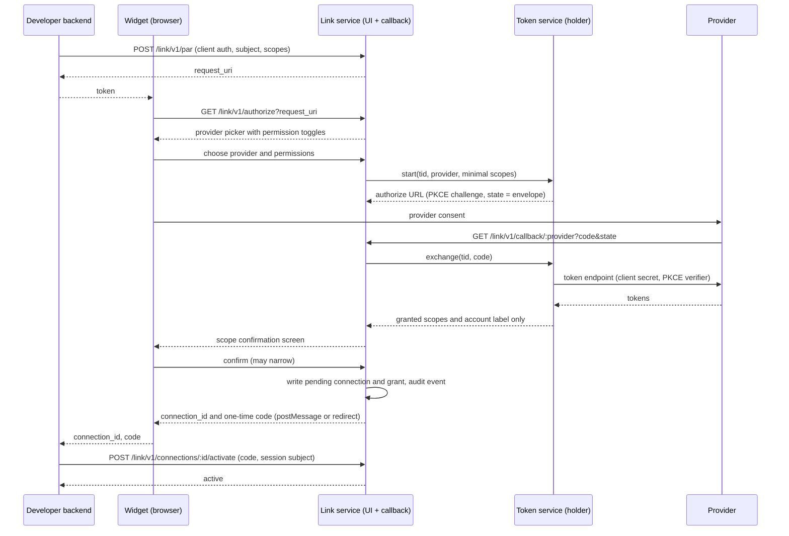

# Cred Link: Product and Technical Spec

Status: rev 6. Phase 1 and its polish round are implemented on branch `feat/cred-link-phase1` (see section 10 for what is and is not built). Written against main at `a41366e` (Oct 6, 2026).

Reading guide. Sections 1 to 9 describe the full design. Text tagged **[Later]** is specified but not built. **[Phase 1]** says what the current build does, where that differs from the design or was added by it. Untagged text is built as written.

Cred Link is a drop-in account-connection widget. A developer embeds it, their end user picks a provider, completes that provider's OAuth flow, confirms granular permissions, and the developer receives a `connection_id`. Raw credentials never reach developer code or an agent runtime. The user's choices become a client-grant record that Guard enforces on every delegation.

## 1. Widget API

The browser never supplies authoritative scopes or identity. The developer's backend pushes the request (section 2) and hands the widget a single-use `token` (the PAR `request_uri`). The `providers` and `scopes` props can only narrow what was pushed.

```ts
// @credninja/link
const link = Cred.link({
  token: string,                               // request_uri, single use, 10 min
  mode?: 'popup' | 'redirect' | 'embedded',    // default 'popup'
  container?: HTMLElement,                     // embedded only
  baseUrl?: string,                            // default https://link.cred.ninja, or a self-hosted server
  providers?: ProviderSlug[],                  // narrowing only
  scopes?: Partial<Record<ProviderSlug, string[]>>, // narrowing only
  theme?: { accent?: string; radius?: number; font?: string; colorScheme?: 'light' | 'dark' | 'auto' }, // cosmetic only
  onSuccess(r: { connection_id: string; code: string; grant_id: string; provider: ProviderSlug; scopes: string[]; state?: string }): void, // pending until activated, section 2
  onError(e: { error: LinkErrorCode; request_id: string; state?: string }): void,
  onExit(m: { step: 'picker' | 'provider' | 'confirm'; provider?: ProviderSlug }): void,
});
link.open(); link.close(); link.destroy();

type LinkErrorCode = 'access_denied' | 'invalid_scope' | 'required_scope_declined'
  | 'provider_error' | 'temporarily_unavailable' | 'server_error';
```

```tsx
// @credninja/link-react
<CredConnect token={token} mode="popup" theme={{ accent: '#4f46e5' }}
  onSuccess={({ connection_id, code }) =>
    // Not usable yet: the connection is pending until your backend activates it.
    fetch('/api/cred/activate', {
      method: 'POST',
      headers: { 'Content-Type': 'application/json' },
      body: JSON.stringify({ connection_id, code }),
    })}
  onError={report} onExit={track}>
  <button>Connect an account</button>
</CredConnect>
// or: const { open, ready } = useCredLink({ token, onSuccess });
```

`onSuccess` is not the end of the flow. It must forward `{ connection_id, code }` to the developer's backend, which adds `subject` from its own session (never from the browser) and calls `POST /link/v1/connections/:id/activate` (section 2). A handler that only stores `connection_id` leaves a connection that never becomes usable and is revoked when the transaction expires.

Hosted versus embedded: `popup` and `redirect` run entirely on Cred-hosted pages. `embedded` renders only the provider picker in an iframe (`frame-ancestors` limited to the client's registered origins). The provider hop and the scope confirmation screen always run top-level with `frame-ancestors 'none'`, because providers refuse framing and a framed consent toggle is a clickjacking target. Results return by an origin-pinned typed `postMessage` (`{type: 'cred.link.result', ...}`, state echoed) or a redirect to the registered `redirect_uri`. The app name and logo on hosted pages come only from the client's registration. Anything the browser supplies is cosmetic, so a page cannot relabel who is asking for consent.

Popup fallback **[Phase 1]**. Popup stays the default, but it depends on `window.opener` surviving the provider hop. The widget acknowledges the result message (`cred.link.ack`). If the opener is gone or no acknowledgement arrives within 2 s, the popup navigates itself to the registered `redirect_uri` with the result plus `cred_link_via=popup` and `cred_link_flow` (the SHA-256 of the widget's token). `Cred.handleRedirect()` on that page offers the result over a same-origin `BroadcastChannel` to the widget whose token hashes to that flow id, and delivers it itself if nobody claims it. Link then remembers the provider as redirect-only in that browser for 30 days (Link-origin storage, written only by a window that started the provider hop with an opener and lost it, which a per-transaction cookie proves): the next time the user picks it, the popup closes and the top window continues in redirect mode. `handleRedirect()` gains `relay?: boolean` and `onRelayed?()`.

## 2. Hosted connect flow

```http
POST /link/v1/par            (client auth: private_key_jwt or client_secret_basic)
{ "intent": "connect",                       // connect | update | reauth
  "subject": "user-123", "subject_type": "user",
  "providers": ["google", "slack"],
  "scopes": { "google": ["calendar.readonly", "gmail.send"] },
  "required_scopes": { "google": ["calendar.readonly"] },
  "authorization_details": [],
  "redirect_uri": "https://app.example.com/cred/return",
  "origin": "https://app.example.com",
  "state": "dev-csrf-value", "agent_id": "agt_1", "connection_id": null }
201 { "request_uri": "urn:cred:link:9f2c...", "expires_in": 600 }
```

Every later hop carries only an opaque envelope, `base64url({"h": <256-bit handle>, "tid": <transaction id>, "cid": <client_id>})`. It is the provider `state` value and the only parameter on hosted pages. Scopes, PKCE verifier, subject, `redirect_uri` and the developer's `state` stay in the server-side transaction. Each hop consumes its handle atomically and issues a new one.

```ts
interface LinkTransaction {
  tid: string; handle_hash: string; client_id: string; org_id: string;
  intent: 'connect' | 'update' | 'reauth';
  subject: string; subject_type: 'user' | 'client';
  requested_scopes: Record<string, string[]>; required_scopes: Record<string, string[]>;
  authorization_details: unknown[]; redirect_uri: string; origin: string; client_state?: string;
  provider?: string; provider_granted_scopes?: string[]; agent_id?: string; connection_id?: string;
  step: 'picker' | 'provider' | 'confirm' | 'done'; expires_at: string; consumed_at?: string;
}
```



The picker requests the smallest provider scope set that covers the user's toggles. The confirmation screen then shows what the provider actually granted, because Google users can untick scopes and several providers grant coarser scopes than requested. `required_scopes` are shown locked on both screens. The flow ends with `required_scope_declined` whenever the confirmed set is missing one, whether the provider withheld it or the confirm submission narrowed it away (the server checks; the locked toggle is only a hint), and the pending tokens are revoked.

Activation. Confirmation writes the connection and grant as `pending` and returns `connection_id` plus a one-time `code`. Nothing is usable until the developer's backend calls `activate` with `{code, subject}`, where `subject` is the user in its own current session. A mismatch with the transaction's subject returns the opaque failure and revokes. This closes consent phishing (an attacker starts a flow under their own subject and sends the hosted URL to a victim, whose account would otherwise land under the attacker) and connection injection. Anything unactivated when the transaction expires, including a flow abandoned after the exchange, is revoked at the provider.

Reconnect **[Phase 1]**. When a `connect` flow lands on a provider account that this (client, subject) already has connected, the confirmation screen shows the current grant next to the new one ("currently X, new Y", with every permission that would be removed called out), so a narrowing replace is never a surprise. Replace semantics stay: the latest confirmed consent is authoritative, including when it is narrower. The transaction records the grant scopes the screen showed. If the grant changes before the user submits, the screen is rendered again with the current diff. If its scopes change between confirm and activation (a narrow, a provider scope reduction, another activation), activation fails closed with the opaque failure and the flow is run again. A status change alone, such as `needs_reauth` after the old token died, does not block activation. The same record-and-compare rule covers `update` and `reauth`.

Re-entry. Handles are single use for effects, not for navigation. The first top-level Link page sets a transaction-binding cookie (`__Host-cred_link_tx`: HttpOnly, Secure, SameSite=Lax, expires with the transaction, carries no identity). A consumed handle presented with the matching cookie is the same browser going back, refreshing or double-submitting: Link re-renders the current step with a fresh handle and invalidates the outstanding one. Effects are keyed by `tid`, so the code exchange and grant write never run twice and a repeated confirm returns the first result. Going back from confirmation to the provider restarts that hop with a new PKCE pair and revokes the earlier pending tokens. Hosted pages are `Cache-Control: no-store`.

Fail-closed error split. Rendered locally on a Cred page with only a request id: unknown, expired or replayed `request_uri`; `client_id` mismatch; unregistered `redirect_uri` or `origin`; invalid envelope; a consumed handle without the matching cookie (the transaction is left untouched); provider callback with unknown `state`. Returned to the client, because the transaction holds a validated `redirect_uri` and origin: `access_denied`, `invalid_scope`, `required_scope_declined`, `provider_error`, `temporarily_unavailable`, `server_error`.

## 3. Scope catalog

Each grant is a client-grant record:

```ts
interface ClientGrant {
  id: `grt_${string}`; org_id: `org_${string}`;
  client_id: string;                 // developer app
  audience: string;                  // provider API origin; exact instance host for Salesforce
  subject: string; subject_type: 'user' | 'client';  // 'client' = workspace or bot install
  scopes: string[];                  // what agents may exercise, subset of connection.provider_scopes
  org_policy: { usage: 'deny' | 'allow' | 'require' };   // [Later] stored in Phase 1, not enforced
  authorization_details_types: string[];
  connection_id: string; status: 'pending' | 'active' | 'needs_reauth' | 'revoked' | 'expired';
  version: number; granted_at: string; updated_at: string; expires_at?: string;
}
```

Agents are not part of the grant, which records what the user allowed this client to do with this account. `agent_id` in the pushed request is optional and does one thing: on activation Link writes an existing-type `Permission` row for (`agent_id`, `connection_id`) with `allowedScopes` equal to the confirmed scopes, `delegatable: false` and `maxDelegationDepth: 0`. Link is deny-by-default per agent: a grant with no `Permission` row for the calling agent is unusable, and `delegate` returns `permission_required`. Passing `agent_id` self-seeds the single-agent case. The backend adds further agents with `POST /connections/:id/permissions`, always within `grant.scopes`. Legacy calls that name no Link connection keep today's behavior, where a missing permission means the stored consent applies.

Catalog entries are `{provider, scope, label, access: 'read' | 'write' | 'admin', risk, enforced_by: 'provider' | 'cred', flags[]}`.

| Provider | Scope | Picker text | Flag |
|---|---|---|---|
| Google | `calendar.readonly` | See your calendars and events | |
| Google | `calendar.events` | Create, change and delete events | Includes delete |
| Google | `gmail.readonly` | Read all your email | Over-broad, restricted scope (security assessment) |
| Google | `gmail.send` | Send email as you | |
| Google | `gmail.compose` | Create drafts and send email | Ambiguous: "compose" includes send |
| Google | `drive.file` | Only files you open with this app | Preferred default |
| Google | `drive.readonly`, `drive` | See, or see and change, every Drive file | Over-broad, restricted |
| Google | `spreadsheets`, `documents` | Read and change all Sheets or Docs | Over-broad. Prefer `drive.file`, or the `.readonly` forms |
| Google | `openid`, `email` | (hidden) | Identity only. Requested silently for a stable account id, never in a grant |
| GitHub | `read:user` | Read your profile | |
| GitHub | `user` | Read and change your profile | Ambiguous: current UI labels it "User" |
| GitHub | `public_repo` | Read and write public repos | No read-only form |
| GitHub | `repo` | Full control of private and public repos | Over-broad: code, hooks, deploy keys |
| GitHub | `workflow` | Change Actions workflow files | Over-broad: can run code with repo secrets |
| Slack | `channels:read` | List public channels | Ambiguous: not message history |
| Slack | `chat:write` | Post messages | Ambiguous: as the app or as the user, depending on token type |
| Slack | `users:read`, `files:write` | See people; upload, edit and delete files | `files:write` includes delete |
| Notion | (none) | Read, update, insert content | Ambiguous: no OAuth scopes. Capabilities are fixed in the integration, pages chosen in Notion's picker. `enforced_by: 'cred'` |
| Salesforce | `api` | Access and manage your data | Over-broad: everything the user can do |
| Salesforce | `refresh_token` | Stay connected | Not a data permission. Request silently, never show as a toggle |
| Linear | `read` | Read workspace data | Always required |
| Linear | `issues:create`, `comments:create` | Create issues; create comments | Preferred over `write` |
| Linear | `write`, `admin` | Change anything; administer workspace | Over-broad. Never offer `admin` |
| HubSpot | `crm.objects.contacts.read` | View contacts | |
| HubSpot | `crm.objects.contacts.write` | Create, change and delete contacts | Includes delete |
| HubSpot | `content`, `automation` | Manage site content; manage workflows | Over-broad |

**[Later]** Where the provider scope is over-broad, the picker shows Cred-enforced sub-permissions (`enforced_by: 'cred'`, method and URL gating in the broker) and tells the user the provider grant itself is broader. **[Phase 1]** The picker offers the provider scopes themselves with their flag text. The broker does not gate by method or by single scope (see the narrowing limits in section 6).

## 4. Cloud architecture

Three hosted components, all shipped inside `@credninja/server` behind `LINK_ENABLED` so the same code self-hosts. **[Phase 1]** They are modules of one server process on SQLite. Running the token service as its own process with its own decryption role and egress allowlist is **[Later]**; in Phase 1 the boundary is a code boundary (the vault refuses Link's reserved ids to every caller except the Link secret store).

Link service: hosted pages, `/link/v1/par`, `/link/v1/authorize`, `/link/v1/callback/:provider`, and the transaction store. It replaces the in-process `pendingOAuth` map with a shared store. It never sees a token.

Token service (pinned-endpoint holder): the only process with the decryption role. Its egress allowlist is each adapter's `tokenUrl` and `revocationUrl`. For providers whose access token never expires (`supportsRefresh === false`: Slack, Notion), the access token is itself a long-lived secret, so the holder also performs the brokered upstream call, pinned to that provider's `SERVICE_ALLOWLIST` origin. For refreshable providers it hands the broker a provider access token for one call, in memory only. It strips tokens from everything it returns and injects them on the way out.

Call-time check. The holder does not trust the broker. Before every injection or hand-off, for every provider, it reloads the connection and grant and refuses with the typed code unless both are `active`, the calling agent holds a `Permission` on the connection, the grant and permission cover the call's scopes, and the Cred token's `grant_id` matches. The grant version is informational: the check runs on every call against current state, and requiring a version match would break outstanding tokens each time a grant is widened. This makes revocation by grant id immediate and is the only gate for Slack and Notion, whose tokens never expire.

Agent tokens. For every provider, agents get a Cred-issued access token: DPoP-bound (`cnf.jkt` of the agent's registered key) **[Later]**, 300 s default, 900 s ceiling (`DEFAULT_DELEGATION_TTL_SECONDS`), carrying `grant_id` and grant version, usable only at `/api/v1/use`. This is today's brokered handle plus a sender constraint. **[Phase 1]** Agents get today's brokered handle without the sender constraint. It carries no provider token: the token is loaded at call time, after the call-time check. Brokered-only is the decision: a raw provider token is a bearer that cannot be sender-constrained and hands the agent the secret the holder exists to keep. Raw issuance exists only behind an operator-set per-client `allow_raw_tokens` flag, never for non-expiring providers, with its own audit event per issuance. **[Phase 1]** A raw token is also refused whenever the delegation is narrower than what the provider granted, because the raw token would carry the difference.

Refresh is single-flight keyed by (client, audience) per connection: take a row lock on the connection, re-check `expires_at` inside the lock, refresh, write the rotated token in one versioned update. All grants reference the connection, so rotation replaces everywhere by construction. `CredVault.get()` currently refreshes without a lock. **[Phase 1]** The lock is in memory, per process, per connection. The cross-process row lock is **[Later]**.

Connection-management API (client auth, tenant-scoped):

```
GET    /link/v1/connections?subject=      list
GET    /link/v1/connections/:id           status, provider, subject, grant
POST   /link/v1/connections/:id/activate  { code, subject }, pending to active, or commits a staged update
DELETE /link/v1/connections/:id           delete secrets, revoke grants; returns provider_revoked
POST   /link/v1/connections/:id/refresh   force refresh, returns status only
POST   /link/v1/connections/:id/reauth    { subject }, returns { request_uri }
POST   /link/v1/connections/:id/permissions  { agent_id, scopes }, within grant.scopes
POST   /link/v1/connections/:id/narrow    { subject, scopes }, shrinks the grant (section 6)
```

Data model, as a Postgres `StorageBackend` **[Later]**. **[Phase 1]** The same shapes on SQLite (Link schema version 2), with the secrets in the existing vault under reserved ids instead of a `connection_secrets` table:

```
link_clients(client_id, org_id, redirect_uris[], origins[], jwks, provider_creds_enc, theme)
connections(id conn_, org_id, client_id, provider, audience, subject, subject_type,
            provider_account_id, provider_scopes[], instance_url, status, custody, version)
            UNIQUE(client_id, audience, subject, provider_account_id)
connection_secrets(connection_id, access_*, refresh_* (enc, iv, tag), expires_at, dek_id)  -- holder role only
client_grants(...ClientGrant)
vault_permissions(existing; allowed_scopes must be a subset of client_grants.scopes)
link_transactions(...LinkTransaction)
audit(existing AuditEvent; resource.type gains 'grant')
```

Multi-tenancy **[Later]**: `org_` ids own clients, clients own connections. Every row carries `org_id` with row-level security, and each org has its own data key wrapped by a KMS key. Hybrid model: `custody` is `hosted` or `self`. **[Phase 1]** Rows carry `org_id`, but there is one tenant, one vault key and `self` custody only. Self-custody runs the same routes on the developer's server against the local vault with `baseUrl` pointed at it. There is no user-auth system: the developer's backend asserts `subject` under client authentication. Hosted pages hold no login session and no identity cookie. The only cookie is the per-transaction binding in section 2.

## 5. Security

| Threat | Control |
|---|---|
| Open redirect, code or result theft | Exact-match `redirect_uri` and `origin` registered per client. Never taken from the browser |
| CSRF, replay, mix-up | Envelope handle is 256-bit, hashed at rest, single use for effects, bound to client, provider and the transaction cookie. PKCE S256 where the adapter supports it |
| Consent phishing (victim completes an attacker's flow) and connection injection | Connection stays `pending` until backend activation with the one-time `code` and the session's `subject` |
| Hijack of an existing connection through `update` or `reauth` | Request must carry the session's `subject`. Link rejects a `connection_id` outside that (client, subject). Same provider account required. Changes staged until `activate` (section 6) |
| Use of a pending or revoked connection | Holder call-time check on every brokered call (section 4) |
| Subject spoofing | `subject` only from the authenticated PAR call. Legacy routes no longer fall back to `default` silently: a request must name `user_id` unless the server runs with `SINGLE_USER_MODE=true`, a verified principal can be bound to one user, and the OAuth start takes its user id from a single-use connect request, not the query string |
| Token theft at rest or in the agent | AES-256-GCM per field and short handles revocable by `grant_id`. **[Later]** per-org keys, holder-only role, DPoP binding |
| A consent confirmed before a later narrowing overwrites it | Activation compares the grant's scopes with the ones the confirmation screen showed and fails closed on a difference (section 2) |
| Enumeration | Unknown client, bad secret, unknown or foreign connection all return the same `401 {"error":"access_denied"}` plus `Cred-Request-Id` |
| Silent grant changes | Fail-closed audit event for every grant create, update, revoke, with before and after scopes |

Protocol behavior. **[Later]** Failed `use` calls return `WWW-Authenticate: DPoP error="insufficient_scope", scope="calendar.events"` (RFC 6750 and 9449 complete, on every 401 and 403), and every response carries `X-RateLimit-Limit`, `X-RateLimit-Remaining` and `X-RateLimit-Reset` as epoch seconds, keyed per client. **[Phase 1]** Failed calls carry the typed code, a request id and, for `insufficient_scope`, the missing scopes in the JSON body. Errors are typed codes only: `grant_revoked`, `grant_expired`, `reauth_required`, `provider_scope_changed`, `insufficient_scope`, `permission_required`, alongside the existing `consent_required` and `scope_escalation_denied`. `grant_reuse_detected` and `subject_disabled` are defined but never emitted yet **[Later]**.

Intersections with existing hardening. Salesforce broker pinning (`resolveBrokerUrl`, PR #39) accepts any host matching the Salesforce grammar. Link stores `instance_url` at connect time and pins the grant audience to that exact host. The vault currently drops `instance_url`. Verified identity (PR #33): Guard's Express middleware infers `identitySource` from request body fields, and the server only fills them from the verified signature when the body left them empty. Link sets Guard identity from verified request state only. Two more gaps to close first: `SERVICE_ALLOWLIST` has no Linear or HubSpot entry, and the current callback renders provider error text and exception messages into HTML.

## 6. Policy engine integration

A new built-in `clientGrantPolicy` runs first in the Guard chain. It loads the grant for (client, audience, subject), denies with the typed code if the status is not `active`, sets `consentedScopes` to `grant.scopes`, and denies or narrows requests outside it. `PolicyResult` gains `code?: string` so callers never parse `reason`. For Link connections it also denies with `permission_required` when the calling agent has no `Permission` row. Enforcement is not opt-in: Guard is optional in the server today and is not mounted on `/api/v1/use`, so with `LINK_ENABLED` the server runs this check on `delegate` and `use` for every call that names a Link connection, whether or not a Guard is configured. `Permission.allowedScopes` must stay within `grant.scopes`. Receipts and sub-delegation attenuate from the permission as today.

Ownership. `update` and `reauth` requests carry `subject` exactly as `connect` does, taken from the backend's current session and never looked up from the connection. The backend must check that the connection belongs to that user before pushing, and Link enforces it: a `connection_id` outside that (client, subject) gets the opaque failure. The flow must finish on the same `provider_account_id`, otherwise it ends in `access_denied` and changes nothing. New scopes and refreshed tokens stay staged until `activate`. Requests Cred mints itself for an agent (`upgrade_uri`, `reauth_url`, `consent_url`) have no session to draw on, so they are fixed to the connection's own subject and rest on the same-account rule and activation. `reauth_url` is built **[Phase 1]**: it is minted only for a `needs_reauth` connection and only for an agent that holds a `Permission` on it. `upgrade_uri` and the pushed `consent_url` are **[Later]**.

Lifetime of minted URLs. An `upgrade_uri` **[Later]** wraps a pushed request and has the same lifetime as the PAR `request_uri`: single use, 10-minute expiry. It is not a standing link. An agent that hits the same missing scope again gets a new one, and a developer must not store one for later. The same already holds for `reauth_url`.

Incremental auth: the backend pushes `intent: "update"` with the `connection_id` and extra scopes. The provider is asked for the union, the user confirms, and on activation the grant's `scopes` and `version` update in place with the same `connection_id` and `grant_id`. An agent that hits a missing scope gets `insufficient_scope` (the challenge header and the `upgrade_uri` the developer shows the user are **[Later]**; in Phase 1 the backend pushes the `update` itself).

Narrowing **[Phase 1]** needs no provider round trip:

```http
POST /link/v1/connections/:id/narrow      (client auth)
{ "subject": "user-123", "scopes": ["gmail.readonly"] }
200 { "connection": { ... }, "changed": true,
      "removed_scopes": ["gmail.send"], "enforcement": "record" }
```

- Ownership is the same as `update`: `subject` comes from the backend's current session, and a connection outside that (client, subject) gets the opaque failure.
- `scopes` must be a non-empty subset of the current `grant.scopes` (compared in canonical form) and must keep every always-required scope. Anything else is `400 invalid_scope`. Removing all access is `DELETE`.
- One store write, under the connection lock, shrinks the grant and bumps its version. It is refused if the grant moved since the request was validated. A fail-closed audit record is written before it, and the grant audit event with before and after scopes after it. Every `Permission` on the connection is then intersected with the new grant through the existing grant-updated hook. That is a second write, not the same statement, because `Permission` rows live in the vault's existing table. The gap fails closed: the call-time check reads the grant on every call, so a not-yet-intersected permission cannot exceed it.
- Repeating the call with the same set is safe: `changed: false`, no version bump, no audit event, and the permission intersect runs again (the repair path if the hook failed the first time).

What narrowing enforces. The provider token is not touched and keeps every scope the provider granted. After a narrow, an agent can no longer request or hold a removed scope, and new handles carry only what is left. `enforcement` says whether brokered calls are restricted too. `broker`: every removed scope took its whole Google API family out of the grant, and the broker refuses URLs of a family the grant no longer covers. `record`: only the records changed. This is the answer for every non-Google provider, and for Google when a removed scope shares a family with one that stays (`gmail.send` removed, `gmail.readonly` kept: the broker checks the API, not read versus write, so sending still works through a handle). To really remove access, run an `update` or `reauth` that asks the provider for fewer scopes, or delete the connection. Per-scope and per-method broker gating is the Cred-enforced sub-permission work in section 3 **[Later]**.

## 7. Re-auth and lifecycle

| Trigger | Result |
|---|---|
| Refresh returns `invalid_grant` | `needs_reauth`, code `grant_revoked` or `grant_expired` |
| Rotated refresh token presented twice | **[Later]** `grant_reuse_detected`, connection frozen, audit event |
| Refresh or upstream reports fewer scopes | `provider_scope_changed`. Grant intersected down, never widened |
| User or developer revokes | `revoked`. Provider revocation where an endpoint exists (Notion has none) |

Agents receive the typed code and a `reauth_url`. **[Later]** Developers receive `connection.needs_reauth`, `connection.revoked` and `grant.updated` by webhook and on the existing SSE audit stream. **[Phase 1]** There are no webhooks and no Link events on the stream: the backend reads status from `GET /link/v1/connections/:id`, and every change is in the audit log. Reconnect is `POST /connections/:id/reauth`, then the widget with that token. The `connection_id` and grant survive. There is no silent auth and no iframe or session-cookie path: headless agents fail with a typed code and a human completes the flow.

## 8. Migration

Link is additive. **[Later]** Existing `(provider, userId)` vault rows get a `connection_id` and a backfilled grant (`client_id` `local`, scopes as stored) on first read. **[Phase 1]** Legacy rows are left as they are and are not Link connections. `/connect/:provider`, `/api/v1/delegate`, the MCP tool names and local mode are unchanged. `delegate` accepts an optional `connection_id`. Calls that name a Link connection default to `token_format: "handle"`, while legacy calls keep today's `raw` default and today's missing-permission behavior. **[Later]** `consent_url` becomes a pushed-request URL when Link is enabled. Moving to hosted custody **[Later]** needs re-consent or uploading the developer's own provider client credentials, because refresh tokens are bound to the OAuth client that minted them.

Provider revocation is conditional. Every client on a server shares its provider OAuth apps, and at Google, Salesforce and Slack one revocation ends the whole authorization for that account. Link revokes at the provider only when no other live connection or open flow on the server uses the same provider account. Otherwise it deletes the local tokens and reports `provider_revoked: false`.

## 9. Open questions

1. Hosted-only callback service, or self-hostable from day one (this spec assumes self-hostable)?
2. Cred-managed shared provider apps, or bring-your-own client only? Shared apps put Cred through Google restricted-scope verification.
3. Metering points: connections, active grants, token issuances, or brokered calls?
4. One agent key for identity and DPoP, or separate keys?
5. Custom domains for hosted pages in v1?
6. A code-relay hybrid (cloud UI, local holder does the exchange) in v1 or later?
7. GitHub: stay on OAuth App scopes or move to a GitHub App for fine-grained permissions?
8. Does `org_policy` need more than `usage` at launch?
9. Default grant expiry: none, or a forced re-confirmation interval?
10. Resolved: narrowing is `POST /link/v1/connections/:id/narrow` (section 6). Still open: whether to build per-scope broker enforcement so that `enforcement` can be `broker` everywhere.
11. Resolved: replace semantics stay, and the confirmation screen shows the diff (section 2).
12. Resolved in code: popup falls back to redirect delivery on its own and remembers the provider (section 1). Still open: the fallback is tested against simulated browsers only. Verify per provider in real browsers before launch, including which providers actually cut the opener.

## 10. Phase 1 implementation status

Built and tested on `feat/cred-link-phase1`, self-hosted behind `LINK_ENABLED` on SQLite: the widget packages; PAR with `client_secret_basic` and `private_key_jwt`; the hosted picker and confirmation pages; envelope, single-use handles and the binding cookie; pending-until-activate; the connection API including permissions; the scope catalog; the client-grant record; the access check on `delegate` and `use` regardless of Guard; deny-by-default permissions; explicit token loading with a per-connection lock and `needs_reauth` on `invalid_grant`; provider scope reduction on refresh; the two pre-existing gap fixes. The polish round added the narrowing endpoint, the reconnect diff, the popup fallback and the crash heal.

Decisions made during the build that this spec did not settle:

- Each connect flow owns its own pending connection. If two flows for one account are both confirmed, the first activation wins and the other fails closed.
- Activation commits the database state first, then moves the tokens under the connection lock. A failure after the commit moves the connection to `needs_reauth`.
- Link tokens live in the vault under reserved user ids (`link:<connection_id>`). The vault refuses those ids to every caller except the Link secret store, and every legacy route rejects them, including when Link is off.
- With one shared `AGENT_TOKEN` the agent id for permission checks is the fixed string `server-agent`. Otherwise it is the verified principal, never a body field.
- Slack connects as a bot install in Phase 1.
- Link handles carry no provider token. The token is loaded at call time, so revocation, narrowing and `needs_reauth` take effect on the next call.

Crash heal: startup sweep, not lazy. Activation commits the database, then moves the staged tokens, then marks the transaction settled (`tokens_settled_at`). A process that dies in between leaves an activated transaction that is not settled. At start, before Link serves any request, the server resolves every such transaction. Where the move finished it only settles. Where it never happened the connection goes to `needs_reauth`, never half-active, with an audit event. Reason for the choice: a lazy check on first use can only see a connection that has no tokens. It cannot see the `update` and `reauth` case, where the connection row already describes the new consent while the vault still holds the old tokens. That connection looks healthy and would keep working with tokens that do not match its grant. Details:

- Two phases. Phase 1 makes the state changes under each connection's lock and makes no network call; requests wait only for it. Phase 2 runs in the background: the provider revocation rule on the staged tokens, deleting them, then settling. A transaction whose move never happened stays unsettled until its phase 2 is done, so a second crash finds it again. One whose move finished is settled in phase 1, and its leftover staged copy is deleted best effort.
- Deciding whether the move finished: no staged copy is left, or the stored tokens equal the staged ones, or the stored tokens can only have come from this transaction (it created the connection, or the stored refresh token is the staged one). A token refresh after the move is therefore not mistaken for a move that never happened.
- Stale rule. The heal touches a connection only if it is still `active` and its `updated_at` still equals the transaction's `activated_at`, which means nothing has written to it since that activation. Otherwise the transaction is stale: its staged copy is deleted locally and never revoked at the provider, because the account may hold newer live tokens.
- The token loader's guard stays as a backstop: an active connection without stored tokens goes to `needs_reauth` on first use.
- The first start after upgrading a schema version 1 database re-checks every earlier activation once.

Other decisions of the polish round:

- Narrow takes `subject` in the body, refuses an empty set and the removal of an always-required scope, and reports `enforcement` (section 6).
- The fallback keeps the server-side transaction in popup mode. "Redirect mode" after a lost opener means the popup window navigates to `redirect_uri` and the result is relayed to the page that opened it; a remembered provider is handed to a top-level redirect from the picker.
- The Link SQLite schema is version 2 (`tokens_settled_at`, `grant_scopes_at_confirm_json`), with a migration from version 1.

Not built in Phase 1: token-service process isolation, DPoP-bound agent tokens, cross-process single-flight refresh (the lock is per process), reuse detection (`grant_reuse_detected`), Postgres and multi-tenancy, webhooks and Link events on the SSE stream, the migration backfill of legacy vault rows, rate-limit headers and `WWW-Authenticate` challenges, Cred-enforced sub-permissions for over-broad scopes, `upgrade_uri` and pushed `consent_url`, and `org_policy` enforcement.

Known limitations: narrowing restricts brokered calls only for whole Google API families (section 6); a crash between the two heal phases leaves a staged token deleted locally but not revoked at the provider; an update or reauth that crashed inside the token move, on a provider that rotates refresh tokens, and was refreshed before the next start is healed to `needs_reauth` although its tokens work; an update or reauth confirmed by a version 1 build and activated after the upgrade is refused and must be run again; the popup relay trusts every script on the developer's origin, and if both pages are blocked for seconds a result can be delivered twice (the code is single use, so the second activation fails); a raw token can carry provider scopes that are outside the catalog; legacy `/connect` connections on the same provider account are invisible to the revocation rule; locks, the `jti` cache and handles are per process.
