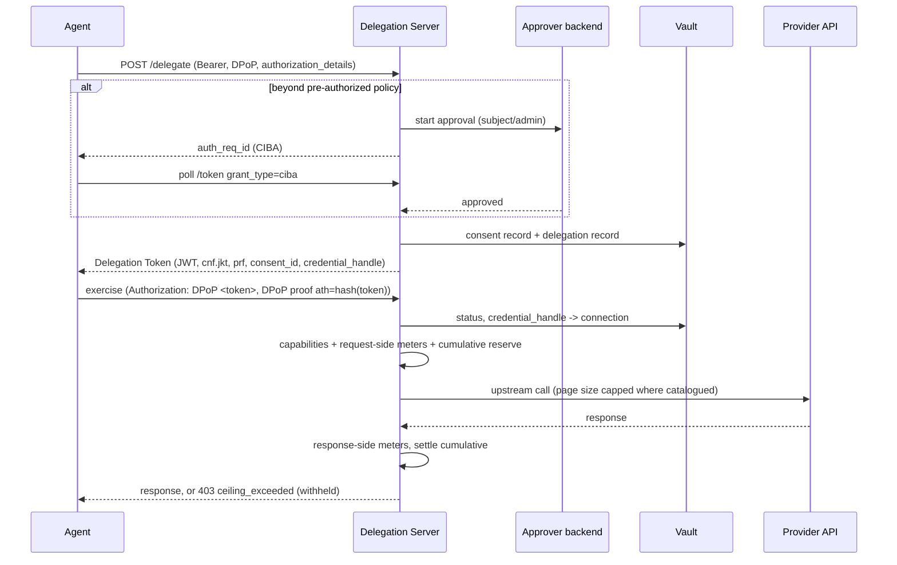

# feat: Delegation Token, capabilities, per-exercise ceilings, consent and CIBA

## Summary

Bring the SDK to the token and consent model of
draft-sweeney-wimse-credential-delegation-02. A DPoP-bound JWT Delegation
Token replaces the opaque handle everywhere, including Cred Link. Capabilities
become RFC 9396 `authorization_details` with a per-provider operation
catalogue. The server meters every exercise itself and enforces per-exercise
and cumulative ceilings. Consent becomes an immutable, retained record, with
CIBA approvals behind pluggable approver backends.

The work lands in seven phases, each its own PR, in dependency order.

---

## Problem Frame

- Agents hold an opaque handle that lives only in one server process's
  memory. A restart or a second replica loses every handle. Authority is
  whatever that map says, not something a verifier can check.
- Capabilities are OAuth scopes only. A hijacked agent with "Drive, read
  only" can read every file.
- Per-exercise ceilings (`max`, `min`, `one_of`, `not_one_of`, `prefix`,
  `rank`) are carried and narrowed hop by hop but never checked at
  exercise. Cumulative ceilings are debited with quantities the agent
  declares, so a misbehaving agent can under-report.
- `requiresApproval` on a permission is refused as unsupported. There are no
  consent records, no `consent_id`, no retention, no re-consent and no CIBA.

---

## Requirements

**Delegation Token**
- R1. `/delegate`, the sub-delegation token exchange, and Link issue a
  Delegation Token. This is a JWS JWT (`typ: dt+jwt`) carrying `iss`, `sub`,
  `client_id`, `act`, `authorization_details`, `delegation_constraints` when
  set, `cnf.jkt`, `iat`, `exp`, `jti`, `consent_id`, `credential_handle` and
  `prf`. The opaque handle is removed.
- R2. Exercise takes `Authorization: DPoP <token>` plus a DPoP proof whose
  `ath` is the SHA-256 of the token (RFC 9449). The token authenticates the
  call, so no deployment Bearer is needed on exercise.
- R3. Delegation state (status, credential handle, consent, capabilities,
  key thumbprint, expiry) is persisted, so tokens survive restarts and work
  across replicas sharing one vault.
- R4. Sub-delegation keeps its two steps. The delegating agent presents its
  token, and the receiving agent redeems a single-use grant with its own
  `actor_token` and a DPoP proof. `prf` gains the new receipt.
- R5. Revocation by `jti` cascades as today. Exercise checks persisted
  status.

**Capabilities**
- R6. Each `authorization_details` entry has type `cred_delegation`, with
  `provider`, `operations` and optional `resources`. An operation is either
  an OAuth scope string or a catalogue name.
- R7. A catalogue maps operation names to method and URL patterns, and
  resource names to URL parts, for Google Drive and GitHub. Unknown
  operation or resource names are refused at issuance and denied at
  exercise. They are never treated as broad.
- R8. Sub-delegation capabilities must be a subset of the parent's. The DS
  validates this.

**Per-exercise ceilings**
- R9. The server measures every exercise. Request-side quantities are
  checked before the upstream call: destination URL, method, calls, request
  bytes, and catalogue request fields. Response-side quantities are checked
  after it: response bytes and catalogue item counts.
- R10. Per-exercise `max`, `min`, `one_of`, `not_one_of`, `prefix` and
  `rank` are enforced. A key the server cannot measure is refused at
  issuance.
- R11. Cumulative ceilings debit server-measured quantities. Client-declared
  `quantities` is removed.
- R12. Where a catalogue operation has a page-size parameter, the request is
  capped so the provider never returns more than the ceiling. Otherwise an
  over-limit response is withheld with `403 ceiling_exceeded`, the measured
  quantity, and an audit event. Responses are never truncated.

**Consent**
- R13. Every root delegation references an immutable consent record that
  names the subject, agent DID, capabilities, grant time, expiry, approver,
  and chain context. `consent_id` names it.
- R14. Records are retained for `CONSENT_RETENTION_DAYS`, minimum 90 and
  default 90. A purge removes expired records and writes an audit-chain
  entry with the count.
- R15. A permission names its approver: the subject (the default), an
  admin, or both. A request beyond pre-authorized policy starts a CIBA
  request.
- R16. CIBA uses `POST /bc-authorize` and the token endpoint with grant
  type `urn:openid:params:grant-type:ciba` and poll mode, returning a
  Delegation Token on approval. Approver backends: a built-in signed-link
  approval page, notified by webhook, and an external CIBA OpenID Provider.
  The interface allows further backends, such as Enterprise.
- R17. Re-consent is triggered by broader capabilities, an expired grant, a
  changed `agent_operator`, or a security event (admin-marked, or agent
  identity revocation and key rotation).

**Clients and Link**
- R18. The TypeScript SDK, Python SDK, MCP and the six integrations use the
  Delegation Token.
- R19. Link agents get a registered key and DPoP. Link delegations are
  recorded, revocable in cascade, and metered like any other.

---

## Scope Boundaries

- The Chain-Verifiable Profile (`agent_delegation` tokens) is unchanged.
- Native resource-server support (draft §6.3) stays future work.
- Cross-DS revocation stays out of scope, as in the draft.

### Deferred to Follow-Up Work

- Operation catalogues for providers other than Google Drive and GitHub.
- Cred Enterprise as an approver backend: the interface ships here, the
  backend does not.
- Admin-approved signatures for scheduled workloads.

---

## Key Technical Decisions

- **Replace, don't add.** Kieran chose a single token format in the
  unreleased 2.0.0. The handle map, `token_format: handle`, and the
  delegation-handle token type are removed.
- **The token is the access token.** Exercise uses standard RFC 9449
  `Authorization: DPoP`. This replaces the Cred-specific profile where
  `ath` covered a handle id and the deployment Bearer stayed in
  `Authorization`.
- **Persisted delegations replace the handle map.** `vault_delegations`
  gains the columns the token's server-side state needs. The provider
  token is loaded from the vault per exercise, as Link already does,
  rather than copied into memory.
- **`prf` is receipt content hashes.** Each entry is the base64url SHA-256
  of a receipt JWS, root first: a content identifier, as the draft says.
- **`credential_handle` is random.** It is an opaque random id mapped
  server-side to the vault connection, so it reveals neither provider nor
  user.
- **Hybrid capabilities, deny by default.** Scopes keep every task
  possible, and catalogue names tighten where they exist. Unknown names
  fail closed.
- **Server-side metering only.** Agents never report quantities. Keys
  without a meter cannot be issued.
- **Prevent first, withhold as backstop.** The threat is a compromised
  tool, dependency or injected prompt bulk-exporting through a legitimate
  delegation. Page-size capping avoids waste where possible, and
  withholding stops the export where it is not.
- **CIBA natively on the agent side, pluggable on the approver side.**
  Every deployment speaks real CIBA to agents. Self-hosted deployments
  approve through the built-in page, and IdP-backed ones through their
  CIBA provider.

---

## High-Level Technical Design

---

## Implementation Units

### U1. Delegation Token core (server, vault, attenuation)

**Goal:** mint, persist and verify Delegation Tokens, and remove the handle.
**Requirements:** R1–R5, R13 (minimal: a consent record per root delegation, from the authorizing permission).
**Dependencies:** none.
**Files:** `packages/attenuation/src/delegation-token.ts` (new: claim types, mint, verify), `packages/vault/src/storage/sqlite.ts`, `packages/vault/src/delegation-revocation.ts`, `packages/vault/src/consent.ts` (new: minimal record), `packages/server/src/server.ts`, `packages/server/src/dpop.ts`, `packages/server/src/delegation-grants.ts`; tests in `packages/attenuation/src/__tests__/delegation-token.test.ts`, `packages/server/src/__tests__/delegation-token.test.ts`, updated `dpop`, `draft02-exchange`, `cascading-revocation`, `subdelegate`, `handle-hardening` and `server` suites.
**Approach:** Mint in `buildDelegationResponse`. Persist via an extended `recordDelegation`. Exercise reads `Authorization: DPoP`, verifies the signature (the receipt keys), `exp`, `cnf.jkt` against the proof, and `ath`, then loads status and credential from the vault. Sub-delegation authorization takes the parent token. The grant redemption returns a token. Keep `cred_req` request binding.
**Execution note:** Test-first for the token claim set and the exercise path.
**Test scenarios:**
- Minted token carries every required claim; `client_id` equals `act.sub`; `exp` no later than receipt lifetime.
- Exercise succeeds with a valid token and proof. It fails for: a proof by another key, `ath` over another token, an expired token, a token signed by another key, `alg: none`.
- A server restart (new process, same vault) still accepts an unexpired token.
- Revoking a root by `jti` fails exercise of every descendant.
- Sub-delegation: the child's `prf` is the parent's plus one hash; the child's `act` nests the delegator; the grant redeemed twice is refused.
- The removed handle paths answer 400 or 404 with a clear error.

**Verification:** every exercise path in the server suites runs on tokens; no handle map remains.

### U2. TypeScript SDK on tokens

**Goal:** `Cred` delegates, sub-delegates, exchanges and exercises with tokens.
**Requirements:** R18 (TS).
**Dependencies:** U1.
**Files:** `packages/sdk/src/cred.ts`, `packages/sdk/src/types.ts`, `packages/sdk/src/identity.ts`, `packages/sdk/src/__tests__/*`.
**Approach:** The result type carries `token`, `expiresIn`, `receipt` and `delegationId` (the token's `jti`). `use` sends `Authorization: DPoP`. Add a client for the grant redemption. Local mode mints tokens with its local key.
**Test scenarios:** happy-path delegate and use; sub-delegation through the grant; local mode round trip; a wrong identity is refused.
**Verification:** SDK suite green; smoke script updated.

### U3. Capabilities and the operation catalogue

**Goal:** `cred_delegation` details, subset validation, and catalogue enforcement.
**Requirements:** R6–R8.
**Dependencies:** U1.
**Files:** `packages/attenuation/src/capabilities.ts` (new), `packages/server/src/catalogue/{google-drive,github,index}.ts` (new), `packages/server/src/server.ts`; tests alongside.
**Approach:** Scope operations reuse the existing scope check and `resolveBrokerUrl`. A catalogue operation matches method and URL template. A resource binds a template variable (folder or file id, owner/repo). Subset: each child detail must be covered by a parent detail for the same provider.
**Test scenarios:** scope-only capability behaves as today; a catalogue operation allows only its endpoint; a resource limits to its folder or repo; an unknown name is refused at issuance and denied at exercise; a child wider than its parent is refused; Drive files in another folder are denied.
**Verification:** the catalogue suite covers every catalogue entry with an allow and a deny case.

### U4. Server-side metering and per-exercise ceilings

**Goal:** measure every exercise and enforce per-exercise and cumulative ceilings.
**Requirements:** R9–R12.
**Dependencies:** U1, U3.
**Files:** `packages/server/src/metering.ts` (new), `packages/attenuation/src/constraints.ts` (evaluate a value against a constraint), `packages/vault/src/cumulative-ledger.ts` (reserve and settle), `packages/server/src/server.ts`; tests alongside.
**Approach:** A meter registry maps keys to request-side or response-side measurement. Issuance refuses unmetered keys and a `max` on running-count keys. Request side: evaluate, cap page size where the catalogue names the parameter, then reserve cumulative totals. Response side: measure, withhold on breach, then settle the reservation to the measured amount.
**Test scenarios:** destination prefix allow and deny; method `one_of`; `max_response_bytes` breach is withheld and audited; Drive list with `max_items` caps `pageSize`; a cumulative total settles to the measured quantity; an upstream failure refunds the reservation; an unmetered key is refused at issuance; a declared `quantities` is ignored.
**Verification:** constraint-boundary suite extended; no client-declared metering remains.

### U5. Consent records, retention, approvers and CIBA

**Goal:** full consent model and approvals.
**Requirements:** R13–R17.
**Dependencies:** U1.
**Files:** `packages/vault/src/consent.ts`, `packages/vault/src/storage/sqlite.ts`, `packages/vault/src/types.ts` (Permission `approver`), `packages/server/src/consent/{ciba,approvers,builtin-page,oidc-ciba,retention}.ts` (new), `packages/server/src/config.ts`, `packages/server/src/server.ts`; tests alongside.
**Approach:** Consent records are append-only and enter the audit chain. Retention is enforced at startup (a minimum of 90 days) and purged on an interval. `requiresApproval`, or a request beyond policy, starts a CIBA request held server-side. The approver backend notifies, and the agent polls the token endpoint. Re-consent checks run at delegate time.
**Test scenarios:** CIBA poll `authorization_pending`, `slow_down`, then a token on approval; denial gives `access_denied`; expiry gives `expired_token`; the built-in page needs a valid signed link and rejects reuse; the external backend is driven by a stub OP; retention below 90 is a startup error; the purge removes only expired records and audits the count; each re-consent trigger forces a new approval.
**Verification:** an approval-required permission works end to end in tests with both backends.

### U6. Python SDK, MCP and integrations

**Goal:** every client on tokens.
**Requirements:** R18.
**Dependencies:** U2.
**Files:** `packages/sdk-python/cred/{client,identity,models}.py`, `packages/mcp/src/{token-cache,tools/*}.ts`, `packages/integrations/*`, examples, READMEs, smoke scripts; tests alongside.
**Approach:** Mirror U2. MCP keeps an LLM-facing id but stores the token, never shows it to the model, and exercises with DPoP.
**Test scenarios:** per client, delegate then use with the token; MCP never returns the token in tool output.
**Verification:** all Python and MCP suites green; smoke scripts pass.

### U7. Link on Delegation Tokens

**Goal:** Link agents registered with a key; Link delegations are tokens.
**Requirements:** R19.
**Dependencies:** U1, U4.
**Files:** `packages/server/src/link/*`, `packages/vault/src/link/*`, `packages/protocol/src/link.ts`; Link test suites.
**Approach:** Link client registration accepts an agent key (JWK or did:key). Link delegate requires DPoP. Link delegations are recorded, take part in cascade revocation, and are metered.
**Test scenarios:** Link delegate without a key is refused; Link exercise needs a DPoP proof; revoking a Link grant revokes its tokens.
**Verification:** Link suites green on tokens.

### U8. Docs, conformance and release notes

**Goal:** documentation matches behaviour.
**Requirements:** all.
**Dependencies:** U1–U7.
**Files:** `docs/protocol-conformance.md`, `AGENTS.md`, `CHANGELOG.md`, `docs/releases/npm-2.0.0.md`, `docs/design/*`, package READMEs.
**Test expectation:** none -- documentation.
**Verification:** the AGENTS.md endpoint table matches `server.ts`; the conformance rows describe the token, capabilities, ceilings and consent as implemented.

---

## Phased Delivery

Each phase is its own PR, in order: U1+U2 (token core and TS SDK), U3,
U4, U5, U6, U7, U8. Docs are updated per phase where behaviour changes. U8
reconciles them at the end.

---

## Risks & Dependencies

- **Breaking change.** Every client changes. 2.0.0 is unreleased, which is
  why replacing is acceptable now. Released Python packages (cred-auth
  1.1.0 and the integrations) need a major bump.
- **Catalogue correctness is security-critical.** A wrong URL pattern
  widens authority. Every entry needs an allow and a deny test.
- **Response withholding happens after the upstream read.** Data reached
  Cred but not the agent. The audit event records it.
- **External CIBA providers differ.** The stub OP covers the spec. Real
  providers need live testing outside CI.
- **Size.** About 100 files reference handles. Phasing keeps each review
  tractable.
